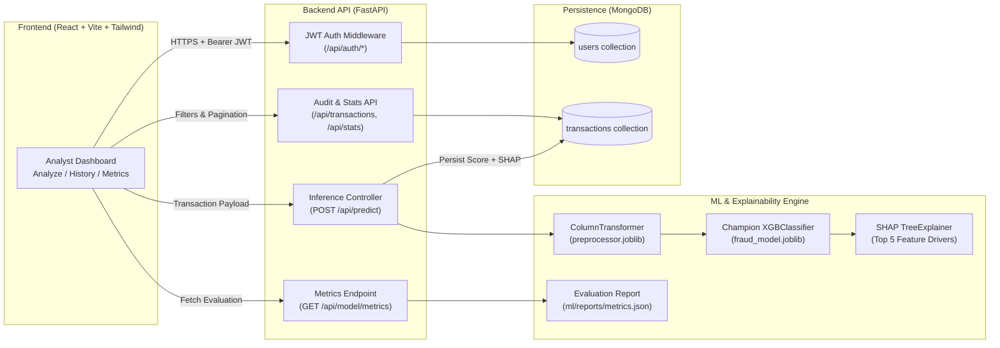

# FraudGuard AI – Explainable Fraud Detection System

> **"Detect risky transactions. Understand why."**

[](https://react.dev/)
[](https://vitejs.dev/)
[](https://tailwindcss.com/)
[](https://fastapi.tiangolo.com/)
[](https://xgboost.readthedocs.io/)
[](https://scikit-learn.org/)
[](https://shap.readthedocs.io/)
[](https://www.mongodb.com/)

**Live Demo:** `<ADD LIVE DEMO URL AFTER DEPLOYMENT>`  
**Backend API Docs (Swagger):** `<ADD BACKEND URL AFTER DEPLOYMENT>/docs`

---

## 📖 Overview

### The Problem
Financial institutions process millions of digital transactions daily, where fraudulent transfers and cash-outs represent a tiny fraction ($< 1\%$) of overall volume but cause severe financial loss. Traditional rule-based engines generate excessive false positives, while "black-box" machine learning models output raw probabilities without explaining *why* a transaction was flagged—leaving compliance analysts unable to justify blocking or clearing an account.

### The Solution
**FraudGuard AI** is a full-stack, explainable fraud detection platform that pairs a cost-sensitive **XGBoost (`XGBClassifier`)** inference pipeline with real-time **SHAP (`TreeExplainer`)** feature attributions. Every transaction evaluated through the system receives:
1. A calibrated **Fraud Probability (`risk_score`)** and binary classification (`Potential Fraud` vs. `Likely Legitimate`).
2. A **3-Tier Operational Risk Level** (`Low`, `Medium`, `High`) mapped to concrete analyst recommendations.
3. A **Local SHAP Attribution Breakdown** quantifying the top 5 features pushing the transaction toward or away from fraud.

### Why Explainability Matters
In regulated financial workflows, a risk score alone is insufficient. By surfacing exact Shapley attributions per transaction (e.g., whether a full origin balance depletion or an off-peak `TRANSFER` drove the alert), FraudGuard AI reduces investigation time, builds analyst trust, and creates an auditable trail stored in MongoDB.

---

## ✨ Key Features

- **JWT Authentication & Role-Aware Access Control**: Secure registration (`/register`), login (`/login`), session restoration via `/api/auth/me`, and protected routes for compliance analysts and administrators.
- **Real-Time Transaction Risk Scoring (`/analyze`)**: Interactive form with validation, balance-consistency warnings, and one-click preset scenarios (*High-Risk Transfer*, *Routine Payment*, *Suspicious Cash-Out*).
- **Local SHAP Explainability**: Computes exact Shapley values on the fly via `shap.TreeExplainer`, merging one-hot encoded categories into human-readable features and visualizing them in a diverging horizontal bar chart (`increases_risk` in coral vs. `decreases_risk` in teal).
- **Executive Monitoring Dashboard (`/dashboard`)**: Displays 4 KPI summary cards, a Risk Level Distribution donut chart, a 30-day Potential Fraud Trend line chart, a Transaction Volume by Type bar chart, and the 8 most recent transactions.
- **Audit History & CSV Reporting (`/history`)**: Server-side pagination, `transaction_id` search, risk level & prediction filters, date-range filtering, slide-over SHAP inspection modal, streaming CSV report export (`/api/report/export`), and admin-only record deletion.
- **Model Performance Transparency (`/model-performance`)**: Live inspection of held-out test set metrics (`PR-AUC`, `ROC-AUC`, `Precision`, `Recall`, `F1-Score`), an interactive $2 \times 2$ Confusion Matrix with derived rates (`Accuracy`, `FPR`, `FNR`), and model metadata.
- **Resilient Demo Mode Fallback**: If model `.joblib` artifacts are missing in a clean environment, the backend automatically degrades gracefully to deterministic heuristic scoring (`is_demo: true`) without crashing.

---

## 🛠️ Tech Stack

| Layer | Technologies |
|---|---|
| **Frontend** | React 19, Vite 8, Tailwind CSS 3.4, React Router v7, Recharts 3, Axios, Lucide React |
| **Backend API** | Python 3.11+, FastAPI, Uvicorn, Pydantic v2, Pydantic Settings |
| **Database** | MongoDB Atlas / Local MongoDB, Motor (async driver), PyMongo, `dnspython` |
| **Authentication** | OAuth2 / JWT (`python-jose`), `passlib` + `bcrypt` password hashing |
| **Machine Learning** | `XGBoost` (`XGBClassifier`), `scikit-learn` (`ColumnTransformer`, `StandardScaler`, `OneHotEncoder`), `pandas`, `numpy`, `joblib` |
| **Explainability (XAI)** | `SHAP` (`shap.TreeExplainer`) for local & global feature attributions |
| **Testing** | `pytest`, `httpx` (`AsyncClient`), `mongomock-motor` |

---

## 🏗️ System Architecture



---

## 🧠 Machine Learning & Explainability

### 1. Dataset & Feature Engineering
The model is trained on the **[PaySim Synthetic Financial Dataset](https://www.kaggle.com/datasets/ealaxi/paysim1)**, which simulates mobile money transactions based on real financial logs.

To prevent data leakage and overfitting to synthetic account IDs:
- **Dropped Columns**: `nameOrig`, `nameDest`, `step`, and `isFlaggedFraud` are removed prior to training.
- **Engineered Feature**: `hour_of_day = step % 24` captures diurnal fraud patterns (such as late-night account draining).
- **7 Input Features**:
  1. `amount` *(float)* – Transaction value (displayed in Rs.)
  2. `transaction_type` *(categorical)* – `PAYMENT`, `TRANSFER`, `CASH_OUT`, `DEBIT`, `CASH_IN`
  3. `hour_of_day` *(int, 0–23)* – Hour of the day when the transaction occurred
  4. `old_balance_origin` *(float)* – Sender balance before the transaction
  5. `new_balance_origin` *(float)* – Sender balance after the transaction
  6. `old_balance_dest` *(float)* – Recipient balance before the transaction
  7. `new_balance_dest` *(float)* – Recipient balance after the transaction
- **Target Variable**: `is_fraud` (`1` = Fraudulent transaction, `0` = Legitimate transaction).
- **Preprocessing (`ColumnTransformer`)**: Stratified 80/20 train-test split is performed *before* fitting `StandardScaler` on the 6 numeric features and `OneHotEncoder(handle_unknown="ignore")` on `transaction_type` (producing 11 transformed features).

### 2. Class Imbalance Strategy
Fraud detection exhibits severe class imbalance ($\approx 0.5\%$ positive class in the stratified sample). Rather than using synthetic oversampling (SMOTE)—which can distort probability calibration and introduce artificial neighborhoods in tree splits—the pipeline uses **cost-sensitive learning**:
- `XGBClassifier`: configured with `scale_pos_weight = n_legit / n_fraud` and optimized with `eval_metric="aucpr"`.
- Candidate baselines (`LogisticRegression` with `class_weight="balanced"` and `RandomForestClassifier` with `class_weight="balanced_subsample"`) are benchmarked via **3-Fold Stratified Cross-Validation**, and the model with the highest **PR-AUC** is automatically promoted.

### 3. Held-Out Test Set Evaluation Metrics
Real metrics read directly from [`ml/reports/metrics.json`](ml/reports/metrics.json) (evaluated on the held-out test set of **6,000 transactions**: 5,970 legitimate and 30 fraud cases at threshold `0.50`):

| Metric | Value | Notes |
|---|---|---|
| **Champion Model** | `XGBClassifier` | Selected via 3-Fold Stratified CV on PR-AUC |
| **Decision Threshold** | `0.50` | Default binary classification cutoff |
| **PR-AUC (Average Precision)** | **0.8246 (82.46%)** | Primary metric for imbalanced fraud detection |
| **ROC-AUC** | **0.9963 (99.63%)** | Area under Receiver Operating Characteristic curve |
| **Precision** | **0.8800 (88.00%)** | 22 of 25 flagged transactions were true fraud |
| **Recall (Sensitivity)** | **0.7333 (73.33%)** | 22 of 30 total fraud cases detected |
| **F1-Score** | **0.8000 (80.00%)** | Harmonic mean of Precision and Recall |
| **Overall Accuracy** | **0.9982 (99.82%)** | $(5967 + 22) / 6000$ |

#### Test Set Confusion Matrix ($N = 6,000$)
| | Predicted Legitimate (`0`) | Predicted Fraud (`1`) |
|---|---|---|
| **Actual Legitimate (`0`)** | **TN = 5,967** | **FP = 3** *(FPR = 0.05%)* |
| **Actual Fraud (`1`)** | **FN = 8** *(FNR = 26.67%)* | **TP = 22** *(TPR = 73.33%)* |

### 4. Risk Tier Thresholds
| Risk Level | Probability Range (`risk_score`) | Prediction Label (`>= 0.50`) | Operational Recommendation |
|---|---|---|---|
| **Low Risk** | `< 0.30` | `Likely Legitimate` | *No action required* |
| **Medium Risk** | `0.30 – 0.70` | `Likely Legitimate` (`< 0.50`) / `Potential Fraud` (`>= 0.50`) | *Monitor this transaction* |
| **High Risk** | `> 0.70` | `Potential Fraud` | *Manual review required* |

---

## 📂 Project Structure

```text
FraudGuard AI/
├── Backend/                        # FastAPI backend service
│   ├── app/
│   │   ├── api/                    # Route controllers
│   │   │   ├── routes_auth.py      # /api/auth/register, /login, /me
│   │   │   ├── routes_model.py     # /api/model/metrics
│   │   │   ├── routes_predict.py   # /api/predict
│   │   │   └── routes_transactions.py # /api/transactions, /api/stats, /api/report/export
│   │   ├── core/
│   │   │   ├── config.py           # Pydantic Settings (.env & path resolution)
│   │   │   └── security.py         # JWT encoding/decoding & bcrypt hashing
│   │   ├── db/
│   │   │   └── mongodb.py          # Async Motor connection & index management
│   │   ├── schemas/                # Pydantic request/response models
│   │   │   ├── model.py
│   │   │   ├── transaction.py
│   │   │   └── user.py
│   │   ├── services/
│   │   │   ├── explain_service.py  # SHAP TreeExplainer service
│   │   │   └── ml_service.py       # XGBoost inference & risk categorization
│   │   └── main.py                 # FastAPI app entrypoint, lifespan & CORS
│   ├── models/                     # Local fallback copy of trained artifacts
│   ├── tests/                      # Pytest unit & integration test suites
│   ├── .env.example                # Backend environment variable template
│   ├── Procfile                    # Process file for Render/Heroku deployment
│   ├── README.md                   # Backend-specific documentation
│   └── requirements.txt            # Pinned Python dependencies
├── frontend/                       # React + Vite + Tailwind CSS SPA
│   ├── src/
│   │   ├── api/                    # Axios instance & typed API modules
│   │   ├── components/
│   │   │   ├── cards/              # StatCard, RiskBadge, ModelInfoCard
│   │   │   ├── charts/             # Recharts visualizations & SHAP bar chart
│   │   │   ├── forms/              # TransactionForm with presets & validation
│   │   │   ├── layout/             # Sidebar, Navbar, AppLayout
│   │   │   ├── tables/             # TransactionsTable, Filters, Modal, Pagination
│   │   │   └── ProtectedRoute.jsx  # Auth route guard
│   │   ├── context/                # AuthContext provider
│   │   ├── hooks/                  # Custom data hooks (Dashboard, History, Metrics)
│   │   ├── pages/                  # Login, Register, Dashboard, Analyze, History, Metrics
│   │   └── utils/                  # Error handling, formatting, feature labels
│   ├── .env.example                # Frontend environment variable template
│   ├── README.md                   # Frontend-specific documentation
│   ├── package.json
│   └── vercel.json                 # Vercel SPA rewrite configuration
├── ml/                             # Offline Machine Learning pipeline
│   ├── data/
│   │   ├── raw/                    # Raw PaySim CSV dataset (git-ignored)
│   │   └── processed/              # Processed splits (git-ignored)
│   ├── models/                     # Committed artifacts (< 200 KB total)
│   │   ├── fraud_model.joblib      # Trained XGBClassifier (191.5 KB)
│   │   ├── preprocessor.joblib     # Fitted ColumnTransformer (2.8 KB)
│   │   └── feature_names.json      # Transformed feature names (0.3 KB)
│   ├── notebooks/
│   │   └── 01_eda.ipynb            # Exploratory Data Analysis notebook
│   ├── reports/                    # Evaluation plots & metrics.json
│   │   ├── eda/                    # 6 EDA chart exports
│   │   ├── confusion_matrix.png
│   │   ├── feature_importance.png
│   │   ├── metrics.json
│   │   ├── precision_recall_curve.png
│   │   ├── roc_curve.png
│   │   ├── shap_summary.png
│   │   └── threshold_analysis.csv
│   ├── src/                        # Modular training & evaluation scripts
│   │   ├── config.py
│   │   ├── preprocess.py
│   │   ├── train.py
│   │   ├── evaluate.py
│   │   └── explain.py
│   ├── tests/                      # ML pipeline unit tests
│   └── requirements.txt
├── docs/
│   └── DEPLOYMENT.md               # Step-by-step cloud deployment guide
├── render.yaml                     # Render Blueprint configuration
├── .gitignore
└── README.md
```

---

## 🔌 API Endpoints

All endpoints are served by the FastAPI application in `Backend/app/main.py`:

| Method | Path | Auth Required | Description |
|---|---|---|---|
| `GET` | `/health` | No | Returns API operational status and `is_demo` flag (`false` when real ML model is active). |
| `GET` | `/health/db` | No | Pings MongoDB and returns `{"status": "ok", "database": "connected"}`. |
| `POST` | `/api/auth/register` | No | Registers a new analyst account (`email`, `password`, `full_name`). Returns `201 Created` or `409 Conflict`. |
| `POST` | `/api/auth/login` | No | Authenticates user credentials (`email`, `password`) and returns a Bearer JWT `access_token`. |
| `GET` | `/api/auth/me` | **Yes (Bearer)** | Returns the profile (`id`, `email`, `full_name`, `role`, `created_at`) of the current user. |
| `POST` | `/api/predict` | **Yes (Bearer)** | Scores a transaction with `XGBClassifier`, computes top 5 SHAP drivers, saves to MongoDB, and returns the result. |
| `GET` | `/api/transactions` | **Yes (Bearer)** | Lists paginated transactions (`page`, `page_size`, `risk_level`, `prediction`, `search`, `date_from`, `date_to`). |
| `GET` | `/api/transactions/{transaction_id}` | **Yes (Bearer)** | Retrieves full details and SHAP attributions for a single transaction. |
| `DELETE` | `/api/transactions/{transaction_id}` | **Yes (Admin)** | Deletes a transaction record from MongoDB (requires `role == "admin"`). |
| `GET` | `/api/stats` | **Yes (Bearer)** | Returns total analyzed count, fraud count, counts per risk level, and 30-day daily fraud trend. |
| `GET` | `/api/report/export` | **Yes (Bearer)** | Streams filtered transaction history as a downloadable `transactions_report.csv` file. |
| `GET` | `/api/model/metrics` | **Yes (Bearer)** | Returns offline test set evaluation metrics and confusion matrix from `ml/reports/metrics.json`. |

---

## 🚀 Getting Started (Local Development on Windows)

### Prerequisites
- **Python 3.11+**
- **Node.js 18+** and **npm**
- **MongoDB** (local MongoDB Community Server on `mongodb://localhost:27017` or a free **MongoDB Atlas** cluster)

### 1. Clone the Repository
```powershell
git clone https://github.com/<your-username>/fraudguard-ai.git
cd "FraudGuard AI"
```

### 2. (Optional) Run the ML Pipeline to Regenerate Models
Pre-trained model artifacts (`ml/models/fraud_model.joblib`, `preprocessor.joblib`, `feature_names.json`) and evaluation metrics (`ml/reports/metrics.json`) are already committed in the repository (`< 200 KB` total), so you can start the backend immediately.

To retrain from scratch using the PaySim CSV dataset:
```powershell
# Place the PaySim CSV file in ml/data/raw/PS_20174392719_1491204439457_log.csv
python -m venv Backend\venv
.\Backend\venv\Scripts\activate
pip install -r ml/requirements.txt

python ml/src/preprocess.py
python ml/src/train.py
python ml/src/evaluate.py
python ml/src/explain.py
```

### 3. Backend Setup (FastAPI)
```powershell
cd Backend
python -m venv venv
.\venv\Scripts\activate
pip install -r requirements.txt

# Copy the environment template and fill in your MONGODB_URI and JWT_SECRET_KEY
copy .env.example .env

# Start the FastAPI server on http://localhost:8000
uvicorn app.main:app --reload --host 0.0.0.0 --port 8000
```
- Verify health check: [http://localhost:8000/health](http://localhost:8000/health)
- Verify database connection: [http://localhost:8000/health/db](http://localhost:8000/health/db)
- Interactive Swagger docs: [http://localhost:8000/docs](http://localhost:8000/docs)

### 4. Frontend Setup (React + Vite)
Open a second PowerShell terminal:
```powershell
cd frontend
npm install

# Copy the environment template (defaults to VITE_API_BASE_URL=http://localhost:8000)
copy .env.example .env

# Start the Vite development server on http://localhost:5173
npm run dev
```
Open [http://localhost:5173](http://localhost:5173) in your browser, create an account on `/register`, and begin analyzing transactions.

---

## 🖼️ Screenshots

> *Add application screenshots to `docs/screenshots/` after deployment:*

- `docs/screenshots/login.png` – Split-screen authentication portal
- `docs/screenshots/dashboard.png` – Executive monitoring dashboard with KPI cards, risk distribution donut, and 30-day fraud trend
- `docs/screenshots/analyze-transaction.png` – Real-time transaction analyzer with risk gauge and diverging SHAP contribution chart
- `docs/screenshots/transaction-history.png` – Filterable audit log with slide-over SHAP detail modal and CSV export
- `docs/screenshots/model-performance.png` – Model evaluation metrics and interactive $2 \times 2$ confusion matrix

---

## ☁️ Deployment

FraudGuard AI is configured for cloud deployment using **MongoDB Atlas** (database), **Render** (FastAPI + ML backend), and **Vercel** (React SPA frontend):

- **`render.yaml` & `Backend/Procfile`**: Pre-configured with `uvicorn app.main:app --host 0.0.0.0 --port $PORT`.
- **`frontend/vercel.json`**: Configured with an SPA rewrite rule so direct navigation to `/dashboard`, `/analyze`, `/history`, and `/model-performance` works on refresh.
- **Full Step-by-Step Guide**: See **[`docs/DEPLOYMENT.md`](docs/DEPLOYMENT.md)** for complete instructions, environment variable tables, smoke tests, and troubleshooting tips.

---

## Limitations & Future Work

This is an educational prototype trained on the simulated PaySim dataset
and is not intended for real financial decisions. Possible next steps:

- Evaluate on more realistic or anonymised datasets
- Add behavioural features such as transaction velocity per customer
- Integrate with a real-time transaction feed
- Add role-based access (analyst / admin) and an audit log
- Monitor model drift and set up periodic retraining
- Tune the risk thresholds against business costs (false alarms vs missed fraud)

---

## 👩‍💻 Author

**Damsarini Nawela**  
- GitHub: [https://github.com/DamsariniNawela](https://github.com/DamsariniNawela) *(update if your GitHub handle differs)*

---

## ⚠️ Disclaimer

This project is built strictly for **educational and portfolio demonstration purposes** using the public, synthetic **PaySim** dataset. The statistical risk scores and SHAP explanations generated by FraudGuard AI are decision-support estimates learned from simulated data and must **not** be used for real-world financial, credit, or legal compliance decisions.
