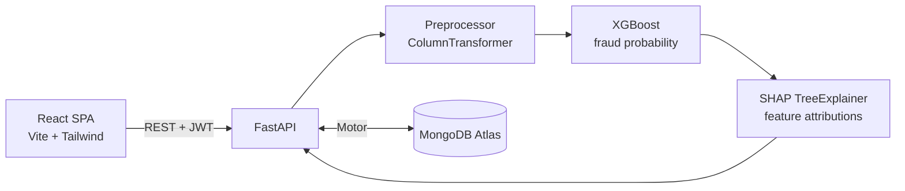

<div align="center">

# 🛡️ FraudGuard AI

### Explainable Fraud Detection System

**Detect risky transactions. Understand why.**


</div>

<!--
Add after deployment:
**Live Demo:** <FRONTEND_URL> | **API Docs:** <BACKEND_URL>/docs
-->

---

## 📑 Table of Contents

- [Overview](#-overview)
- [Highlights](#-highlights)
- [Who Is This For?](#-who-is-this-for)
- [Key Features](#-key-features)
- [Example Walkthrough](#-example-walkthrough)
- [Tech Stack](#-tech-stack)
- [System Architecture](#-system-architecture)
- [Machine Learning & Explainability](#-machine-learning--explainability)
- [Project Structure](#-project-structure)
- [API Endpoints](#-api-endpoints)
- [Getting Started](#-getting-started)
- [Testing](#-testing)
- [Security Notes](#-security-notes)
- [Deployment](#-deployment)
- [Limitations & Future Work](#-limitations--future-work)
- [License](#-license)
- [Author](#-author)
- [Disclaimer](#-disclaimer)

---

## 📖 Overview

### The Problem

Financial institutions process millions of digital transactions every day. Fraudulent transfers and cash-outs are a tiny fraction of the volume but cause severe losses. Rule-based engines produce many false positives, and black-box ML models return a probability without saying *why* a transaction was flagged. That leaves analysts unable to justify blocking or clearing an account.

### The Solution

FraudGuard AI is a full-stack, explainable fraud detection platform. It pairs a cost-sensitive **XGBoost** classifier with **SHAP** feature attributions. Every analyzed transaction receives:

- A **fraud probability** (`risk_score`) and a prediction label (Potential Fraud / Likely Legitimate)
- A **three-tier risk level** (Low, Medium, High) with an analyst recommendation
- A **SHAP breakdown** of the top features pushing the score toward or away from fraud
- A **plain-language explanation** of why the transaction looks risky or normal

### Why Explainability Matters

In regulated financial workflows, a score alone is not enough. Showing *which factors* drove an alert (for example an emptied origin account or a night-time TRANSFER) reduces investigation time, builds analyst trust, and creates an auditable record in MongoDB.

---

## 🌟 Highlights

| | |
| :--- | :--- |
| 🎯 **End-to-end ML** | Preprocessing, training, evaluation and explainability scripts, all reproducible |
| 🔍 **Explainable by design** | SHAP `TreeExplainer` attributions on every prediction |
| ⚖️ **Imbalance-aware** | Cost-sensitive learning with `scale_pos_weight`, judged by PR-AUC rather than accuracy |
| 🧪 **What-If Sandbox** | Change inputs with sliders and watch the model react live, with nothing saved |
| 🔐 **Secured API** | JWT authentication, bcrypt password hashing, protected routes |
| 📊 **Analyst workflow** | Dashboard, searchable audit history, CSV export, model performance page |
| 📝 **Honest metrics** | All reported numbers come directly from `ml/reports/metrics.json` |

---

## 👥 Who Is This For?

- **Fraud analysts** at banks and mobile-money providers who need a score *and* the reasons behind it
- **Risk and compliance teams** who must justify why a transaction was flagged
- **Learners** studying explainable ML in a realistic full-stack project
- **Recruiters and reviewers** looking for an end-to-end data science and web engineering portfolio project

---

## ✨ Key Features

- **Authentication:** JWT-based register, login and session restore, with protected routes and role-aware access (admin-only record deletion).
- **Real-time risk scoring:** Analyze form with validation, quick-fill example scenarios, an animated risk gauge and a SHAP contribution chart.
- **Plain-language reasons:** A "Why this result" section that explains the verdict in readable sentences, with a recommendation that matches the risk level.
- **What-If Sandbox:** Adjust a hypothetical transaction with sliders and see the score, verdict and explanation update live without saving to the database.
- **Monitoring dashboard:** KPI cards, risk distribution donut, fraud trend line chart, volume-by-type bar chart and recent transactions.
- **Audit history and reporting:** Server-side pagination, search, risk/prediction/date filters, SHAP detail modal and CSV export.
- **Model transparency:** Held-out test metrics (PR-AUC, ROC-AUC, Precision, Recall, F1), a 2×2 confusion matrix and model metadata.
- **Graceful fallback:** If model artifacts are missing, the backend falls back to heuristic scoring (`is_demo: true`) instead of crashing.
- **Responsive UI:** Works on desktop and mobile, with a collapsible sidebar and tables that scroll inside their cards.

---

## 🧭 Example Walkthrough

An analyst opens **Analyze Transaction**, enters the details below and clicks **Analyze**.

| Field | Suspicious example | Routine example |
| :--- | :--- | :--- |
| Type | `TRANSFER` | `PAYMENT` |
| Amount | 900,000 | 250 |
| Hour of day | 3 | 14 |
| Origin balance (before → after) | 900,000 → 0 | 5,000 → 4,750 |
| Destination balance (before → after) | 0 → 0 | 0 → 0 |

The system returns a risk score, a risk level (Low / Medium / High), an analyst recommendation, a SHAP chart and a plain-language explanation.
Typical red flags it surfaces: the sender's account being emptied, a TRANSFER or CASH_OUT type, and a night-time hour. Typical normal signals: a PAYMENT type, a small amount, daytime hours and a healthy remaining balance.

Exact scores come from the trained model, so they may vary slightly between retrains.

The **What-If Sandbox** tab lets the analyst start from either example and change one input at a time (for example the hour or the type) to see which factor moves the score most.

---

## 🛠️ Tech Stack

| Layer | Technologies |
| :--- | :--- |
| **Frontend** | React 19, Vite 8, Tailwind CSS 3.4, React Router 7, Recharts 3, Axios, Lucide React |
| **Backend** | Python 3.11+, FastAPI, Uvicorn, Pydantic v2 |
| **Database** | MongoDB Atlas, Motor (async driver), PyMongo, dnspython |
| **Authentication** | JWT (python-jose), passlib + bcrypt |
| **Machine Learning** | XGBoost, scikit-learn, pandas, NumPy, joblib |
| **Explainability** | SHAP (`TreeExplainer`) |
| **Testing** | pytest, httpx, mongomock-motor |
| **Deployment** | Vercel (frontend), Render (backend), MongoDB Atlas (database) |

---

## 🏗️ System Architecture



**Request flow:** the analyst submits a transaction, FastAPI preprocesses it, XGBoost returns a fraud probability, SHAP explains it, the result is stored in MongoDB and returned to the dashboard.

---

## 🧠 Machine Learning & Explainability

### 1. Dataset and Features

The model is trained on the **PaySim** synthetic mobile-money dataset (Kaggle).

- **Dropped columns:** `nameOrig`, `nameDest`, `step`, `isFlaggedFraud` (avoids leakage on synthetic IDs)
- **Engineered feature:** `hour_of_day = step % 24`
- **Target:** `is_fraud` (1 = fraud, 0 = legitimate)

| Feature | Type | Description |
| :--- | :--- | :--- |
| `amount` | numeric | Transaction value |
| `transaction_type` | categorical | PAYMENT, TRANSFER, CASH_OUT, CASH_IN, DEBIT |
| `hour_of_day` | numeric (0–23) | Hour the transaction occurred |
| `old_balance_origin` | numeric | Sender balance before |
| `new_balance_origin` | numeric | Sender balance after |
| `old_balance_dest` | numeric | Recipient balance before |
| `new_balance_dest` | numeric | Recipient balance after |

**Preprocessing:** stratified 80/20 split, then `StandardScaler` on the 6 numeric features and `OneHotEncoder(handle_unknown="ignore")` on `transaction_type` (11 transformed features).

> The model treats amounts as unitless numbers. The UI displays them in Rs. purely for presentation.

### 2. Class Imbalance

Fraud is a very small positive class. Instead of SMOTE, the pipeline uses cost-sensitive learning:

- `XGBClassifier` with `scale_pos_weight = n_legit / n_fraud` and `eval_metric="aucpr"`
- Baselines (Logistic Regression, Random Forest) are benchmarked with 3-fold stratified cross-validation, and the model with the best PR-AUC is promoted

### 3. Test Set Results

Read from `ml/reports/metrics.json` (held-out test set of 6,000 transactions: 5,970 legitimate, 30 fraud; threshold 0.50):

| Metric | Value | Notes |
| :--- | :--- | :--- |
| **Champion model** | `XGBClassifier` | Selected by 3-fold CV on PR-AUC |
| **PR-AUC** | 0.8246 | Primary metric for imbalanced data |
| **ROC-AUC** | 0.9963 | |
| **Precision** | 0.8800 | 22 of 25 flagged transactions were fraud |
| **Recall** | 0.7333 | 22 of 30 fraud cases detected |
| **F1-Score** | 0.8000 | |
| **Accuracy** | 0.9982 | Misleading alone on imbalanced data |

**Confusion matrix (N = 6,000)**

| | Predicted Legitimate | Predicted Fraud |
| :--- | :---: | :---: |
| **Actual Legitimate** | TN = 5,967 | FP = 3 |
| **Actual Fraud** | FN = 8 | TP = 22 |

The test set contains only 30 fraud cases, so these figures carry statistical uncertainty and should be read as indicative rather than definitive.

### 4. Risk Tiers

| Risk Level | Score Range | Recommendation |
| :--- | :--- | :--- |
| 🟢 **Low** | < 0.30 | No action required |
| 🟡 **Medium** | 0.30 – 0.70 | Manual review required |
| 🔴 **High** | > 0.70 | Review immediately |

The prediction label is **Potential Fraud** when the score is ≥ 0.50.

---

## 📂 Project Structure

```text
FraudGuard AI/
├── Backend/                      # FastAPI service
│   ├── app/
│   │   ├── api/                  # Route handlers
│   │   │   ├── routes_auth.py
│   │   │   ├── routes_model.py
│   │   │   ├── routes_predict.py
│   │   │   └── routes_transactions.py
│   │   ├── core/                 # Settings, JWT and password hashing
│   │   ├── db/                   # MongoDB connection and indexes
│   │   ├── schemas/              # Pydantic models
│   │   ├── services/             # ml_service.py, explain_service.py
│   │   └── main.py
│   ├── tests/
│   ├── .env.example
│   ├── Procfile
│   └── requirements.txt
├── Frontend/                     # React + Vite + Tailwind
│   ├── src/
│   │   ├── api/                  # Axios instance and API modules
│   │   ├── components/           # cards, charts, forms, layout, tables
│   │   ├── context/              # AuthContext
│   │   ├── hooks/
│   │   ├── pages/                # Login, Register, Dashboard, Analyze, History, Model Performance
│   │   └── utils/
│   ├── .env.example
│   ├── package.json
│   └── vercel.json
├── ml/                           # Offline ML pipeline
│   ├── data/                     # Raw and processed data (git-ignored)
│   ├── models/                   # fraud_model.joblib, preprocessor.joblib, feature_names.json
│   ├── notebooks/                # EDA notebook
│   ├── reports/                  # metrics.json and evaluation plots
│   └── src/                      # preprocess, train, evaluate, explain
├── docs/
│   └── DEPLOYMENT.md
├── render.yaml
├── LICENSE
└── README.md
```

---

## 🔌 API Endpoints

| Method | Path | Auth | Description |
| :--- | :--- | :---: | :--- |
| `GET` | `/health` | No | API status and `is_demo` flag |
| `GET` | `/health/db` | No | MongoDB connectivity check |
| `POST` | `/api/auth/register` | No | Create an account (201, or 409 if the email exists) |
| `POST` | `/api/auth/login` | No | Authenticate and receive a JWT |
| `GET` | `/api/auth/me` | Bearer | Current user profile |
| `POST` | `/api/predict` | Bearer | Score a transaction, compute SHAP drivers, save to MongoDB |
| `GET` | `/api/transactions` | Bearer | Paginated list with search and filters |
| `GET` | `/api/transactions/{transaction_id}` | Bearer | Full details and SHAP for one transaction |
| `DELETE` | `/api/transactions/{transaction_id}` | Admin | Delete a transaction record |
| `GET` | `/api/stats` | Bearer | Totals, risk distribution and 30-day trend |
| `GET` | `/api/report/export` | Bearer | Download transactions as CSV |
| `GET` | `/api/model/metrics` | Bearer | Offline evaluation metrics and confusion matrix |

Interactive Swagger docs are available at `/docs` when the backend is running.

---

## 🚀 Getting Started

### Prerequisites

- Python 3.11+
- Node.js 18+ and npm
- A MongoDB Atlas cluster (free tier) or a local MongoDB instance

### 1. Clone

```bash
git clone https://github.com/damsaraninawela2002-ux/FraudGuard-AI.git
cd "FraudGuard AI"
```

### 2. Backend

```bash
cd Backend
python -m venv venv
.\venv\Scripts\activate
pip install -r requirements.txt
copy .env.example .env
uvicorn app.main:app --reload --host 0.0.0.0 --port 8000
```

Edit `.env` and set `MONGODB_URI` and `JWT_SECRET_KEY` before starting. Then verify:

| Check | URL |
| :--- | :--- |
| Health | http://localhost:8000/health |
| Database | http://localhost:8000/health/db |
| Swagger docs | http://localhost:8000/docs |

### 3. Frontend

Open a second terminal:

```bash
cd Frontend
npm install
copy .env.example .env
npm run dev
```

The app runs at http://localhost:5173. Create an account on `/register` and start analyzing transactions.

### 4. (Optional) Retrain the Model

Pre-trained artifacts are already committed in `ml/models/`, so retraining is not required. To retrain, place the PaySim CSV in `ml/data/raw/` and run:

```bash
pip install -r ml/requirements.txt
python ml/src/preprocess.py
python ml/src/train.py
python ml/src/evaluate.py
python ml/src/explain.py
```

### Environment Variables

| File | Variable | Purpose |
| :--- | :--- | :--- |
| `Backend/.env` | `MONGODB_URI` | MongoDB connection string |
| `Backend/.env` | `JWT_SECRET_KEY` | Secret used to sign JWTs |
| `Backend/.env` | `DB_NAME` | Database name (e.g. `fraudguard_db`) |
| `Frontend/.env` | `VITE_API_BASE_URL` | Backend base URL (default `http://localhost:8000`) |

See the `.env.example` files for the full list. Real `.env` files are never committed.

---

## 🧪 Testing

```bash
cd Backend
pytest
```

The backend test suite covers authentication, prediction and transaction endpoints using `httpx` and `mongomock-motor`, so no live database is required. ML pipeline tests live in `ml/tests/`.

---

## 🔐 Security Notes

- Passwords are hashed with bcrypt and never stored in plain text
- API access is protected with JWT bearer tokens; unauthorized requests return `401`
- Destructive actions (record deletion) require the admin role
- Secrets are read from environment variables; `.env` files and raw datasets are git-ignored
- CORS origins are configurable through environment variables

---

## ☁️ Deployment

| Component | Platform |
| :--- | :--- |
| Database | MongoDB Atlas |
| Backend (FastAPI + ML) | Render (`render.yaml`, `Backend/Procfile`) |
| Frontend (React SPA) | Vercel (`Frontend/vercel.json` handles SPA routing) |

See [`docs/DEPLOYMENT.md`](docs/DEPLOYMENT.md) for the full step-by-step guide, environment variables, smoke tests and troubleshooting.

---

## 🔭 Limitations & Future Work

This is an educational prototype trained on the simulated PaySim dataset. It is not intended for real financial decisions.

**Known limitations**

- PaySim is synthetic and easier to separate than real-world fraud, so real performance would be lower
- The model uses transaction-level features only; there is no customer history, device or location data
- Transactions are entered manually rather than streamed from a live feed
- The test set contains only 30 fraud cases, so metrics have wide uncertainty

**Possible next steps**

- Evaluate on more realistic or anonymised datasets
- Add behavioural features such as transaction velocity per customer
- Integrate with a real-time transaction feed
- Extend role-based access with a full audit log and analyst review workflow
- Monitor model drift and set up periodic retraining
- Tune risk thresholds against business costs (false alarms vs missed fraud)

---

## 📄 License

This project is developed for educational purposes.
---

## 👩‍💻 Author

**Damsarini Nawela**
HNDIT student, Advanced Technological Institute – Rathnapura

[](https://github.com/damsaraninawela2002-ux)
[](https://www.linkedin.com/in/damsarini-nawela-0816243ba)

---

## ⚠️ Disclaimer

This project is built for educational and portfolio purposes using the public, synthetic PaySim dataset. The risk scores and SHAP explanations are decision-support estimates learned from simulated data and must not be used for real-world financial, credit or legal decisions.
